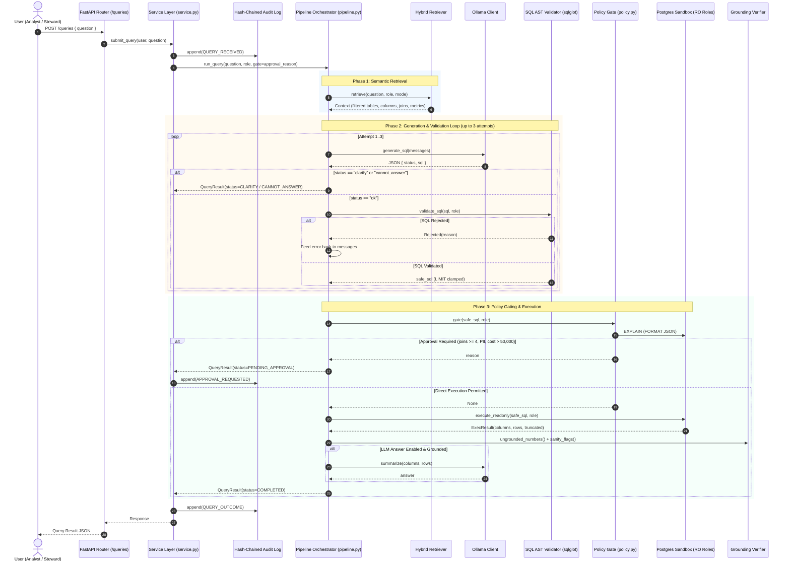
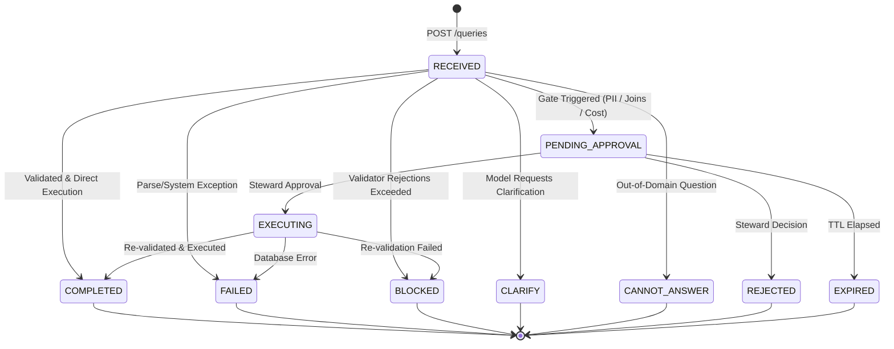

# Architecture Notes: Governed Analytics Copilot

This document describes the end-to-end architecture and runtime lifecycle of the Governed Analytics Copilot, tracing the execution path from natural language question input through retrieval, iterative SQL generation, AST validation, policy gating, human-in-the-loop approvals, sandboxed database execution, answer grounding, and tamper-evident audit logging.

All descriptions are grounded in the concrete implementation under `backend/app/`.

---

## 1. Architectural Philosophy & Core Invariants

The fundamental architectural principle of the system is:
> **The LLM is an untrusted generator, never a security boundary.**

To enforce this principle across every layer:
1. **Defense in Depth**: Access control is enforced at the semantic layer, the SQL AST validator, and the database grant level.
2. **Tool Allow-listing**: The pipeline can only invoke explicit, allow-listed tools (`retrieve`, `generate_sql`, `validate_sql`, `execute_readonly`, `explain`, `summarize`).
3. **No Dynamic DDL/DML**: The system only generates, validates, and executes single read-only `SELECT` queries.
4. **Approval Never Bypasses Security**: Human-approved queries are always re-validated against AST policies and executed through read-only database roles.
5. **Tamper-Evident Audit Trail**: Every lifecycle transition is recorded in an append-only, SHA-256 hash-chained log serialized with database-level advisory locks.

---

## 2. End-to-End Flow Diagram

---

## 3. Layer-by-Layer Technical Architecture

### 3.1 Ingestion & Authentication Layer
- **Source**: `backend/app/api/queries.py`, `backend/app/auth/`
- **Authentication**: JWT Bearer tokens decoded into `User` models (`id`, `username`, `role`).
- **Role Permissions**:
  - `analyst`, `steward`, `admin` can submit queries.
  - `auditor` has read-only access to audit logs and verification endpoints, but is denied query submission.
- **Data Role Mapping**:
  `DATA_ROLE` in `backend/app/auth/models.py` maps the user application role to the corresponding database permissions role:
  - `analyst` -> `analyst`
  - `steward` -> `steward`
  - `admin` -> `steward`
- **Execution Modes**:
  - **Synchronous** (`stream=false`): Directly calls `service.submit_query`, returning full results once finished.
  - **Asynchronous / Streaming** (`stream=true`): Creates query record, dispatches processing to `BackgroundTasks`, and streams step-by-step progress events over Server-Sent Events (SSE) via `GET /queries/{id}/events`.

### 3.2 Semantic Layer & Role-Filtered Retrieval
- **Source**: `backend/app/semantic/loader.py`, `backend/app/retrieval/retriever.py`
- **Semantic Specification**: `backend/app/semantic/olist.yaml` defines tables, column types, descriptions, relationships (joins), business metrics, and column sensitivity (`public` vs `pii`).
- **Catalog Poisoning Defense**:
  - Text fields in `olist.yaml` are scanned by `scan_text_fields()` for prompt injection signatures (e.g. `ignore all previous instructions`).
  - Catalog loading validates referential integrity across joins and metric column definitions.
- **Role Isolation in Retrieval**:
  - When `role == "analyst"`, the retriever strictly excludes PII columns (`customer_email`, `customer_phone`) from all searchable documents and context metadata.
  - The analyst's retriever never indexes or embeds sensitive columns, preventing retrieval poisoning or indirect prompt leakage.
- **Hybrid Retrieval Strategy**:
  - **BM25**: Lexical token matching using `rank_bm25.BM25Okapi`.
  - **Dense Vector Search**: Sentence embeddings generated via `BAAI/bge-small-en-v1.5` with on-disk caching (`.cache/emb/`) keyed by SHA-256 hash.
  - **Reciprocal Rank Fusion (RRF)**: Merges ranked lists using $RRF(d) = \sum \frac{1}{60 + r_i(d)}$.
  - **Join Graph Expansion**: Uses `networkx` to compute minimum join paths connecting candidate tables.

### 3.3 Tool Allow-List & Sandboxing
- **Source**: `backend/app/governance/tools.py`
- All operations performed by the pipeline are encapsulated into registered tools and strictly checked against `ALLOWED_TOOLS`:
  1. `retrieve`: Extracts context from the semantic layer.
  2. `generate_sql`: Calls the LLM with structured prompts.
  3. `validate_sql`: Runs AST verification via sqlglot.
  4. `execute_readonly`: Executes validated SQL with timeout against read-only database connections.
  5. `explain`: Computes Postgres query planner cost.
  6. `summarize`: Drafts natural language answers from query rows.
- Any attempt to invoke an unregistered or unallowed tool raises `ToolNotAllowed`.

### 3.4 Generation & Iterative Self-Correction Loop
- **Source**: `backend/app/pipeline.py`, `backend/app/generation/prompt.py`
- Prompt incorporates:
  - System instructions specifying read-only PostgreSQL rules and strict JSON output schema.
  - Domain rules and join conditions relevant to retrieved tables.
  - Table schemas and descriptions filtered by role permissions.
  - Canonical business metric definitions.
- **Contract**: Model must respond with JSON:
  - `{"status": "ok", "sql": "..."}`
  - `{"status": "clarify", "message": "..."}`
  - `{"status": "cannot_answer", "message": "..."}`
- **Repair Loop**:
  - Up to `MAX_ATTEMPTS = 3` attempts.
  - If the validator rejects the generated SQL, the specific rejection message is appended to the message conversation history, prompting the LLM to fix the syntax or policy violation on its next attempt.

### 3.5 SQL AST Validation & Semantic Boundary
- **Source**: `backend/app/validation/sql_validator.py`
- Built on `sqlglot` using the PostgreSQL dialect.
- **Invariants Enforced**:
  - **Comment Stripping / Denial**: Comments (`--`, `/* */`) are rejected to prevent comment-based filter evasion.
  - **Single Statement**: Multiple statements (delimited by `;`) are rejected to prevent query chaining.
  - **Strict Operation Allowlist**: Root node must be `exp.Select`. Any forbidden AST nodes (`Insert`, `Update`, `Delete`, `Create`, `Drop`, `Alter`, `Copy`, `Grant`, `Merge`, `Set`) raise `Rejected`.
  - **No Locking / Dynamic Targets**: `SELECT INTO` and row locks (`FOR UPDATE`, `FOR SHARE`) are blocked.
  - **No Wildcard Stars**: `SELECT *` and `t.*` are forbidden (except `COUNT(*)`), requiring explicit column projections so all accessed data is auditable.
  - **Schema Isolation**: Only queries against the `analytics` schema (or explicit CTE aliases) are allowed. Cross-schema references to `app.*` (internal user/audit state) or system catalogs (`pg_catalog`, `information_schema`) are rejected.
  - **Function Blocking**: Dangerous or exfiltration functions (`current_setting`, `dblink`, `pg_sleep`, `version`, `inet_server_addr`, etc.) or functions prefixed with `pg_`, `lo_`, `dblink` are blocked.
  - **Column Permission Matrix**: Every referenced column is resolved against `allowed_map(semantic, role)`. If an analyst references `customer_email`, validation fails.
  - **Alias Shadowing Prevention**: Column aliases cannot reuse or shadow restricted column names.
  - **Automatic Row Capping**: Enforces a maximum row limit (`LIMIT 1000`). If a query omits `LIMIT` or specifies a limit $> 1000$, the AST is rewritten with `LIMIT 1000`.

### 3.6 Policy Gates & Approval State Machine
- **Source**: `backend/app/governance/policy.py`, `backend/app/governance/approvals.py`
- **Policy Gates** (`approval_reason`):
  Evaluated on validated SQL before execution:
  1. *Sensitive Columns*: Query accesses designated sensitive/PII columns.
  2. *Join Complexity*: Number of joins $\ge$ `settings.approval_join_threshold` (default: 4).
  3. *Cost Threshold*: Query planner estimated cost via `EXPLAIN (FORMAT JSON)` exceeds `settings.approval_cost_threshold` (default: 50,000).
- **Approval Workflow**:
  - If a gate triggers, the query transitions to `PENDING_APPROVAL`, a pending record is created in `app.approvals` with an expiration TTL, and `APPROVAL_REQUESTED` is logged.
  - **State Machine Rules**:
    - Permitted decision makers: `steward` or `admin`.
    - **No Self-Approval**: Users cannot approve their own queries (`SelfApproval` error).
    - **Written Reason**: A non-empty explanation of at least 5 characters is mandatory (`ReasonRequired`).
    - **Concurrency & Idempotency**: Handled using `SELECT ... FOR UPDATE` row locks; duplicate decisions by the same actor are idempotent, while conflicting decisions are rejected (`AlreadyDecided`).
    - **Expiration**: Requests past their TTL automatically transition to `EXPIRED`.
- **Post-Approval Execution**:
  - Approving a query atomically sets status to `EXECUTING` and calls `execute_approved(sql, role)`.
  - **Critical Guarantee**: `execute_approved` re-validates the SQL through the AST validator and executes strictly through the read-only database role. Approvals never bypass security checks.

### 3.7 Database Execution Sandboxing
- **Source**: `backend/app/sandbox/executor.py`, `backend/scripts/setup_roles.py`
- Execution connects to Postgres via role-specific credentials:
  - `analyst_ro`: Granted `SELECT` on `analytics.*` except sensitive columns (`customers.customer_email`, `customers.customer_phone`). No permissions on `app.*`.
  - `steward_ro`: Granted `SELECT` on all `analytics.*` tables.
- **Connection Guards**:
  - `conn.read_only = True` enforces a read-only Postgres transaction at the protocol level.
  - `statement_timeout = 5000ms` terminates long-running or resource-intensive queries.
  - `cur.fetchmany(max_rows + 1)` detects if results were truncated at the row cap.

### 3.8 Grounding & Hallucination Guard
- **Source**: `backend/app/validation/grounding.py`
- If enabled (`settings.llm_answer = True`), an LLM summary of the SQL result is generated via the `summarize` tool.
- **Numerical Fact-Checking**:
  - `claimed_numbers()` extracts all numerical figures (including scientific notations and scales like "million", "k", "%") from the drafted summary.
  - Every extracted number is checked against `result_numbers()` derived from the actual rows and columns returned by PostgreSQL.
  - If any number in the answer is not present in the SQL result set (or question), `hallucination_flag` is set to `True`, the hallucinated answer is rejected, and a flag is recorded.
- **Sanity Flags**:
  - Flags empty results, row truncation, negative values in naturally non-negative metrics (e.g. freight, count, revenue), and out-of-range ratings (review scores outside 1–5).

### 3.9 Append-Only Hash-Chained Audit Trail
- **Source**: `backend/app/governance/audit.py`
- **Cryptographic Structure**:
  - Each entry in `app.audit_log` links to the previous entry's SHA-256 hash, forming a linear blockchain-like structure starting from the genesis hash (`"0" * 64`).
  - Preimage:
    $$\text{SHA256}(\text{json\_dumps}([\text{prev\_hash}, \text{ts}, \text{actor}, \text{actor\_role}, \text{event}, \text{query\_id}, \text{payload}]))$$
  - Timestamps (`ts`) are stored in microsecond ISO format in UTC.
- **Concurrency & Anti-Forking**:
  - Serialized using Postgres transaction-level advisory locks:
    `SELECT pg_advisory_xact_lock(727001)`
  - Prevents race conditions and chain forks during concurrent query execution.
- **PII Scrubbing**:
  - All audit payloads pass through `mask()` / `_mask_obj()`, which masks email addresses and phone numbers before writing to disk.
- **Chain Integrity Verification**:
  - Verified via `GET /audit/verify` (`verify_chain()`).
  - Iterates through all records from ID 1 to head, confirming that `prev_hash` matches the prior record's hash and that re-computing the preimage hash matches `hash`.
  - Detects any modification, insertion, or deletion of audit records.

---

## 4. Query Lifecycle State Machine

---

## 5. Security & Isolation Matrix

| Capability / Entity | Analyst (`analyst`) | Steward (`steward`) | Auditor (`auditor`) |
| :--- | :--- | :--- | :--- |
| **Ask Natural Language Queries** | Yes (`POST /queries`) | Yes (`POST /queries`) | No (403 Forbidden) |
| **Visible Schema in Retrieval** | Public columns only | Public + PII columns | None |
| **Customer Email / Phone Access** | Denied (AST + DB grants) | Allowed | Denied |
| **Max SQL Rows Returned** | 1,000 (enforced cap) | 1,000 (enforced cap) | N/A |
| **Decide Pending Approvals** | No (403 Forbidden) | Yes (`POST /approvals/{id}`) | No (403 Forbidden) |
| **Self-Approval of Own Queries** | Denied | Denied | Denied |
| **Internal App Tables (`app.*`)** | Denied (Postgres grants) | Denied (Postgres grants) | Read-only audit access |
| **View Audit Log & Verify Chain** | Denied | Yes (`GET /audit`) | Yes (`GET /audit/verify`) |

---

## 6. Verification & Test Suite Summary

The guarantees documented above are validated by the test suite in `backend/tests/`:
- `test_validator.py`: Verifies AST safety, comment stripping, multi-query blocking, schema isolation, and column allowlists.
- `test_grants.py`: Verifies PostgreSQL engine permissions (`analyst_ro` vs `steward_ro`), ensuring database-level enforcement matches application policies.
- `test_security_destructive.py`: Asserts denial of all DDL, DML, and injection attacks.
- `test_security_matrix.py`: Comprehensive combinatorial matrix tests for table and column level permissions across roles.
- `test_approvals.py`: Tests the server-side approval state machine, expiration, self-approval prevention, and approval execution.
- `test_audit.py`: Validates advisory locking, SHA-256 chaining, PII masking, and detection of broken chains or tampered payloads.
- `test_grounding.py`: Asserts numerical claim verification and hallucination detection on generated answers.
